<div align="center">

# termreel

**Record terminal sessions and turn them into lightweight animated SVGs for your README.**




</div>

---

## Table of contents

1. [The problem](#the-problem)
2. [What termreel does](#what-termreel-does)
3. [Quick start](#quick-start)
4. [Demo: one script, three outputs](#demo-one-script-three-outputs)
5. [Demo script specification](#demo-script-specification)
6. [Emulator specification](#emulator-specification)
7. [Architecture](#architecture)
8. [Output format](#output-format)
9. [Key design decisions](#key-design-decisions)
10. [Testing and CI](#testing-and-ci)
11. [Limitations and roadmap](#limitations-and-roadmap)

---

## The problem

GIFs of terminal demos are blurry, heavy and can't be selected or zoomed. Video can't go in a README at all. And re-recording a demo every time the output changes means getting every keystroke right in one take.

## What termreel does

termreel replays your session through its own terminal emulator and writes a single self-contained SVG: crisp at any zoom, themeable, usually tens of kilobytes, and it animates inside a plain `` tag, which is how GitHub renders README images. No JavaScript, no runtime dependencies.

- **Two ways to capture.** Record a live shell (`termreel record`), or write a *demo script*: a small text file that types commands at a human pace, actually runs them, and can fake output. Scripts give you reproducible demos you can edit and re-render instead of re-recording.
- **A real terminal emulator.** Escape sequences are interpreted, not stripped.
- **Looks right.** Block characters (`█▓▒░▁▂▃`) are drawn as shapes so progress bars have no seams. Text runs are pinned to the cell grid so columns line up whatever monospace font the viewer has.
- **Accessible.** `role="img"` and an `aria-label`. Viewers with `prefers-reduced-motion` see the final frame as a still image.
- **Six themes:** `dracula`, `one-dark`, `nord`, `monokai`, `solarized-dark` and `github-light`.
- **Compatible.** Reads asciinema `.cast` files (v2 and v3) and writes v2.

## Quick start

```bash
pip install .
termreel render examples/demo.reel -o demo.svg
```

```bash
termreel record session.cast                 # record your shell; exit to stop
termreel record demo.cast -c "npm test"      # record a single command
termreel render session.cast -o demo.svg     # .cast -> animated SVG
termreel render demo.reel -t nord            # script -> SVG in one step
termreel render demo.reel --at 4.5 -o still.svg   # a still frame at 4.5s
termreel script demo.reel -o demo.cast       # script -> .cast
termreel play demo.cast --speed 2            # replay in your terminal
termreel themes                              # preview the themes
```

### Usage and options

| `render` option | Default | Meaning |
| --- | --- | --- |
| `-t, --theme` | `dracula` | colour theme |
| `--speed` | `1.0` | playback speed multiplier |
| `--idle` | `1.5` | cap any pause at this many seconds |
| `--fps` | `30` | maximum frame rate; output arriving faster is batched |
| `--loop-delay` | `3.0` | how long to hold the last frame before looping |
| `--no-loop` | | play once and stop on the last frame |
| `--no-window` | | no title bar, just the terminal |
| `--at SECONDS` | | render a single still frame |
| `--font-size` | `14` | |
| `--cols / --rows` | from recording | override the terminal size |

Live recording on Windows needs `pip install pywinpty` (or `pip install .[windows]`). Demo scripts work everywhere with no extra packages.

## Demo: one script, three outputs

[`examples/demo.reel`](examples/demo.reel) builds a site with live progress bars, prints a file table and pushes with git. From that one script:

- [`examples/demo.svg`](examples/demo.svg): the animated SVG at the top of this page.
- [`examples/demo-dracula.svg`](examples/demo-dracula.svg) and [`examples/demo-github-light.svg`](examples/demo-github-light.svg): the same session in other themes.
- `termreel render examples/demo.reel --at 4.5 -o still.svg`: a single still frame.

Typing rhythm is randomized but seeded, so re-rendering produces an identical file.

## Demo script specification

```text
# examples/demo.reel
@size 64x18
@title termreel demo
@prompt [bold #61afef]~/site[/] [#c678dd]❯[/]
@typing 20

$ python build.py                 # typed, then really executed
~ git push                        # typed, but not executed...
> [dim]To github.com:you/site.git[/]    # ...so we print its output
>    [yellow]a1f9e3c..7bd20c4[/]  main -> main
@sleep 2
```

| Line | Meaning |
| --- | --- |
| `$ cmd` | type `cmd`, run it, record its output in real time |
| `~ cmd` | type `cmd` without running it |
| `> text` | print a line of output |
| `@prompt text` | the prompt shown before each command |
| `@size COLSxROWS`, `@title`, `@typing CPS`, `@sleep S`, `@clear` | setup and pacing |

Markup in `>` and `@prompt` lines: `[bold]`, `[dim]`, `[italic]`, `[underline]`, `[strike]`, colour names (`[red]`, `[bright-cyan]`), backgrounds (`[on-blue]`), hex colours (`[#ff8800]`), combinations such as `[bold red on-black]`, and `[/]` to reset. Write `[[` for a literal `[`.

Commands run by `$` get `FORCE_COLOR=1` and `CLICOLOR_FORCE=1`, so most tools keep their colours even though their output goes to a pipe.

## Emulator specification

`Terminal` is a character-at-a-time state machine (ground, escape, CSI, OSC) that updates a grid of cells, each with a character and a style. It handles:

- 16, 256 and truecolor SGR, including colon-form truecolor
- cursor movement, erase, insert and delete, scroll regions
- the alternate screen, `\r` progress bars and multi-line redraws
- wide CJK and emoji characters, and OSC window titles
- escape sequences split across chunks, because the state persists between `feed()` calls

## Architecture

```
 .cast file ─┐
             ├─► events (t, bytes) ─► Terminal emulator ─► snapshots ─► SVG renderer
 .reel script┘   idle-capped, sped up      (terminal.py)     per frame     (render.py)
```

1. **Emulation.** Bytes are fed to `Terminal`, which keeps the screen state.
2. **Framing.** Events are bucketed at `--fps`, long pauses are capped, and each bucket produces one immutable, hashable `Snapshot`.
3. **Rendering.** The snapshots become SVG elements, deduplicated as described under [Output format](#output-format).
4. **Animation.** All distinct frames are stacked vertically into a *filmstrip* inside a clipping viewport. One CSS `@keyframes` track moves the strip to each frame using `steps(1,end)` timing. The cursor has its own track and its own blink animation.

```
termreel/
  terminal.py   VT/xterm emulator -> Snapshots
  render.py     Snapshots -> animated SVG (dedup, filmstrip, CSS animation)
  script.py     .reel demo scripts and their markup
  record.py     live pty recording (pty on POSIX, pywinpty on Windows)
  cast.py       asciinema v2/v3 reader and v2 writer
  themes.py     colour themes and the xterm 256-colour palette
  cli.py        command-line entry point
```

## Output format

One self-contained SVG. What keeps it small:

| Technique | Effect |
| --- | --- |
| **Frame dedup**: identical screens map to one filmstrip position | an idle prompt that reappears costs nothing |
| **Row dedup**: each distinct line of styled text is a `<defs>` entry placed with `<use>` | a line on screen for 200 frames is drawn once |
| **Prefix chaining**: a row that only extends a recent row is `<use>` of that row plus the new characters | typing a command adds about one glyph per frame, not a whole line |
| **Cursor on its own track** | frames that differ only in cursor position merge |
| **Styles as CSS classes**: `.f3{fill:#…;font-weight:bold}` | no repeated attributes |
| **Trimming**: rows that are never used are cropped | no empty space under short demos |

On `examples/hello.reel` (112 frames), prefix chaining and the cursor track together took the output from 53.8 KB to 26.8 KB.

## Key design decisions

### 1. Emulate, don't strip

Stripping escape codes breaks progress bars, redraws and full-screen apps. Interpreting them gives the screen the viewer would actually have seen.

### 2. CSS animation, not JavaScript

GitHub renders README images in an `` tag, where scripts never run. A CSS filmstrip animates there; a JS player would show nothing.

### 3. Scripts as a first-class input

A `.reel` file is a reproducible demo: edit a line, re-render, and the SVG is byte-for-byte deterministic.

### 4. Standard library only

No runtime dependencies, so `pip install .` works anywhere Python 3.10 does. `pywinpty` is optional and only for live recording on Windows.

## Testing and CI

```bash
python -m unittest discover -s tests -v
```

35 tests cover the emulator (wrapping, scrolling, scroll regions, insert and delete, SGR parsing including colon-form truecolor, wide characters, the alternate screen, sequences split across chunks), cast v2 and v3 parsing, script markup and timing, and the renderer's guarantees: valid XML, escaping, deduplication, prefix chaining, idle capping, still frames and themes.

## Limitations and roadmap

**Known limitations:**

- Glyphs come from the viewer's monospace font, so box-drawing and emoji can look slightly different between systems.
- Very long recordings produce a tall filmstrip; trimming idle time with `--idle` keeps them reasonable.

**Roadmap:**

- A GitHub Action that re-renders demo SVGs when `.reel` files change.
- More themes, and custom themes from a JSON file.

---

<div align="center">

MIT License · Built by <b>BlazeXYZ</b> · Part of <a href="https://blazexyz.com">blazexyz.com</a>

</div>
