<div align="center">

# termreel

**Record terminal sessions and turn them into lightweight animated SVGs for your README.**

[](https://pypi.org/project/termreel/)




</div>

---

## Table of contents

1. [The problem](#the-problem)
2. [What termreel does](#what-termreel-does)
3. [Quick start](#quick-start)
4. [Demo: one script, three outputs](#demo-one-script-three-outputs)
5. [Demo script specification](#demo-script-specification)
6. [Themes](#themes)
7. [Emulator specification](#emulator-specification)
8. [Architecture](#architecture)
9. [Output format](#output-format)
10. [Key design decisions](#key-design-decisions)
11. [Testing, CI and releases](#testing-ci-and-releases)
12. [Limitations and roadmap](#limitations-and-roadmap)

---

## The problem

GIFs of terminal demos are blurry and heavy, and you can't select or zoom the text. Video can't go in a README at all. On top of that, re-recording a demo every time the output changes means getting every keystroke right in one take.

## What termreel does

termreel replays your session through its own terminal emulator and writes a single self-contained SVG. It stays sharp at any zoom, it's usually tens of kilobytes, and it animates inside a plain `` tag (which is how GitHub shows README images). There is no JavaScript and there are no runtime dependencies.

- **Two ways to capture.** Record a live shell with `termreel record`, or write a *demo script*. A demo script is a small text file that types commands at a human pace, really runs them, and can fake output. Because of this, you can edit a demo and re-render it instead of recording it again.
- **A real terminal emulator.** Escape sequences are interpreted, not stripped.
- **Looks right.** Block characters (`█▓▒░▁▂▃`) are drawn as shapes, so progress bars have no seams. Text is pinned to the cell grid, so columns line up whatever monospace font the viewer has.
- **Accessible.** The SVG has `role="img"` and an `aria-label`. Viewers who ask for reduced motion see the final frame as a still image.
- **Themes.** Ten built-in themes, plus your own themes from a small JSON file. See [Themes](#themes).
- **Compatible.** Reads asciinema `.cast` files (v1, v2 and v3) and writes v2.

## Quick start

```bash
pip install termreel
termreel render examples/demo.reel -o demo.svg
```

```bash
termreel record session.cast                 # record your shell, exit to stop
termreel record demo.cast -c "npm test"      # record a single command
termreel render session.cast -o demo.svg     # .cast -> animated SVG
termreel render demo.reel -t nord            # script -> SVG in one step
termreel render demo.reel -t my-theme.json   # use a custom theme file
termreel render demo.reel --at 4.5 -o still.svg   # a still frame at 4.5s
termreel script demo.reel -o demo.cast       # script -> .cast
termreel play demo.cast --speed 2            # replay in your terminal
termreel themes                              # list the themes
```

### Usage and options

| `render` option | Default | Meaning |
| --- | --- | --- |
| `-t, --theme` | the script's `@theme`, else `dracula` | a theme name or a path to a `.json` theme |
| `--speed` | `1.0` | playback speed multiplier |
| `--idle` | `1.5` | cap pauses in a recording at this many seconds (a script's `@sleep` is kept as written) |
| `--fps` | `30` | maximum frame rate, and output arriving faster is batched |
| `--loop-delay` | `3.0` | how long to hold the last frame before looping |
| `--no-loop` | | play once and stop on the last frame |
| `--no-window` | | no title bar, just the terminal |
| `--at SECONDS` | | render a single still frame |
| `--font-size` | `14` | |
| `--cols / --rows` | from recording | override the terminal size |

Numbers are checked up front, so `--speed 0` gives a clear error instead of a crash.

Live recording on Windows needs `pip install pywinpty` (or `pip install termreel[windows]`). Demo scripts work everywhere with no extra packages.

## Demo: one script, three outputs

[`examples/demo.reel`](examples/demo.reel) builds a site with live progress bars, prints a file table and pushes with git. From that one script you get:

- [`examples/demo.svg`](examples/demo.svg), the animated SVG at the top of this page.
- [`examples/demo-dracula.svg`](examples/demo-dracula.svg) and [`examples/demo-github-light.svg`](examples/demo-github-light.svg), the same session in other themes.
- A single still frame with `termreel render examples/demo.reel --at 4.5 -o still.svg`.

The typing rhythm is random but seeded. A script with no `$` commands renders to the same file byte for byte every time. Commands run with `$` bring their real timing with them, so their output can land a few milliseconds differently from one render to the next.

The terminal demos in [pwaudit](https://github.com/BlazeXYZ/pwaudit), [authtrail](https://github.com/BlazeXYZ/authtrail), [portscan-fingerprint](https://github.com/BlazeXYZ/portscan-fingerprint), [MailSleuth](https://github.com/BlazeXYZ/mailsleuth), [Secret Time Machine](https://github.com/BlazeXYZ/secret-time-machine), [Regex Replay](https://github.com/BlazeXYZ/regex-replay), [Blast Radius](https://github.com/BlazeXYZ/blast-radius) and [Pathfinder Playground](https://github.com/BlazeXYZ/pathfinding-playground) are all rendered from `.reel` scripts in each repo's `docs/` folder.

## Demo script specification

```text
# examples/demo.reel
@size 64x18
@title termreel demo
@prompt [bold #61afef]~/site[/] [#c678dd]❯[/]
@typing 20

$ python build.py                 # typed, then really executed
~ git push                        # typed, but not executed...
> [dim]To github.com:you/site.git[/]    # ...so we print its output
>    [yellow]a1f9e3c..7bd20c4[/]  main -> main
@sleep 2
```

| Line | Meaning |
| --- | --- |
| `$ cmd` | type `cmd`, run it, and record its output in real time |
| `~ cmd` | type `cmd` without running it |
| `> text` | print a line of output |
| `@prompt text` | the prompt shown before each command |
| `@theme NAME` | the theme to render with, either a name or a `.json` file next to the script (`-t` still wins) |
| `@size COLSxROWS`, `@title`, `@typing CPS`, `@clear` | setup and pacing |
| `@sleep S` | pause for exactly S seconds (`--idle` does not shorten it). A `@sleep` at the end holds the final screen. |
| `@cwd PATH` | run later `$` commands in PATH, relative to the script's folder (`@cwd ..` lets a script in `docs/` run from the repo root) |
| `@max-lines N` | show only the first N lines of each command's real output, then a dim `… 57 more lines` (0 shows everything) |

Lines can be indented, and a mistake gives an error with the file and line number, for example `demo.reel: line 7: @sleep needs a number, got 'x'`.

Markup in `>` and `@prompt` lines: `[bold]`, `[dim]`, `[italic]`, `[underline]`, `[strike]`, `[inverse]`, color names (`[red]`, `[bright-cyan]`), backgrounds (`[on-blue]`), hex colors (`[#ff8800]` or `[#f80]`), combinations such as `[bold red on-black]`, and `[/]` to reset. Write `[[` for a literal `[`.

Commands run by `$` get `FORCE_COLOR=1`, `CLICOLOR_FORCE=1` and `TERM=xterm-256color`, so most tools keep their colors even though their output goes to a pipe. Their input is closed, so a command that asks a question fails right away instead of waiting forever.

## Themes

termreel ships with ten themes: `dracula`, `one-dark`, `nord`, `monokai`, `solarized-dark`, `solarized-light`, `github-light`, `gruvbox-dark`, `catppuccin-mocha` and `tokyo-night`. There is also `template`, the documented theme that new themes start from. The [theme gallery](docs/themes/README.md) has a preview of each one.

A theme is a small JSON file, so making your own takes a couple of minutes:

```bash
termreel themes init my-theme.json      # copy the documented template
termreel themes preview my-theme.json   # render a sample terminal in it
termreel themes check my-theme.json     # catch typos and low contrast
termreel render demo.reel -t my-theme.json
```

A theme only needs a background, a foreground and the 16 ANSI colors. It can also set the cursor, title bar, title text and window buttons. With `"extends"` a theme can start from another one and change only a few colors:

```json
{
  "name": "nord-warm",
  "extends": "nord",
  "palette": { "red": "#e06c75", "yellow": "#f2c879" }
}
```

To use a theme by name instead of by path, put it in your user theme folder (`~/.config/termreel/themes`, or `%APPDATA%\termreel\themes` on Windows) or in a folder listed in `TERMREEL_THEME_PATH`. Then `-t my-theme` works from anywhere.

The full walkthrough, with every key explained, is in [docs/custom-themes.md](docs/custom-themes.md).

| `themes` command | What it does |
| --- | --- |
| `termreel themes` | list every theme you can use by name |
| `termreel themes init FILE [--from THEME]` | start a theme from the template, or from a copy of another theme |
| `termreel themes check FILE... [--strict]` | validate theme files (`--strict` also fails on warnings) |
| `termreel themes preview THEME [-o FILE]` | render a sample terminal in a theme |
| `termreel themes show THEME` | print a theme as complete JSON |
| `termreel themes gallery [DIR]` | write previews of every built-in theme plus a README table |

## Emulator specification

`Terminal` is a character-at-a-time state machine (ground, escape, CSI, OSC and string states) that updates a grid of cells, each with a character and a style. It handles:

- 16, 256 and truecolor SGR, including colon-form colors such as `38:2::r:g:b`, plus bold, dim, italic, underline, inverse, strike-through and hidden text
- cursor movement, erase, insert and delete, insert mode, autowrap on and off, tabs and repeat (`CSI b`), and scroll regions
- the alternate screen, `\r` progress bars and multi-line redraws
- wide CJK and emoji characters, combining marks and zero-width joiners. Overwriting half of a wide character blanks the other half, the same way xterm does it.
- the DEC line-drawing character set (`ESC ( 0`), which ncurses and `dialog` fall back to
- window resizes (`CSI 8;rows;cols t`, and `r` events in cast files), with the SVG sized for the largest screen
- OSC window titles. DCS, APC and PM strings are swallowed so they never leak onto the screen.
- escape sequences split across chunks, because the state persists between `feed()` calls

Numeric parameters are capped, so a corrupt or hostile recording can't make the emulator loop for a very long time.

## Architecture

```
 .cast file ─┐
             ├─► events (t, text) ─► Terminal emulator ─► snapshots ─► SVG renderer
 .reel script┘   idle-capped, sped up     (terminal.py)     per frame     (render.py)
                                                                   ▲
                                         theme JSON ─► Theme ──────┘
                                                      (themes/)
```

1. **Emulation.** Text is fed to `Terminal`, which keeps the screen state.
2. **Framing.** Events are grouped at `--fps`, long pauses are capped, and each group produces one immutable, hashable `Snapshot`.
3. **Rendering.** The snapshots become SVG elements, with repeats removed as described under [Output format](#output-format). Colors come from the chosen `Theme`.
4. **Animation.** All distinct frames are stacked vertically into a *filmstrip* inside a clipping viewport. One CSS `@keyframes` track moves the strip to each frame using `steps(1,end)` timing. The cursor has its own track and its own blink animation.

```
termreel/
  terminal.py   VT/xterm emulator -> Snapshots
  render.py     Snapshots -> animated SVG (dedup, filmstrip, CSS animation)
  script.py     .reel demo scripts and their markup
  record.py     live pty recording (pty on POSIX, pywinpty on Windows)
  cast.py       asciinema v1/v2/v3 reader and v2 writer
  themes/       theme loading, validation and previews
    builtin/    the built-in themes, one JSON file each
    template.json   the documented starting point for new themes
  cli.py        command-line entry point
```

## Output format

The output is one self-contained SVG. This is what keeps it small:

| Technique | Effect |
| --- | --- |
| **Frame dedup**: identical screens map to one filmstrip position | an idle prompt that comes back costs nothing |
| **Row dedup**: each distinct line of styled text is a `<defs>` entry placed with `<use>` | a line on screen for 200 frames is drawn once |
| **Prefix chaining**: a row that only extends a recent row is a `<use>` of that row plus the new characters | typing a command adds about one glyph per frame, not a whole line |
| **Cursor on its own track** | frames that differ only in cursor position merge |
| **Styles as CSS classes**: `.f3{fill:#…;font-weight:bold}` | no repeated attributes |
| **Trimming**: rows that are never used are cropped | no empty space under short demos |

On `examples/hello.reel` (112 frames), prefix chaining and the cursor track together took the output from 53.8 KB to 26.8 KB.

## Key design decisions

### 1. Emulate, don't strip

Stripping escape codes breaks progress bars, redraws and full-screen apps. Interpreting them gives the screen the viewer would actually have seen.

### 2. CSS animation, not JavaScript

GitHub shows README images in an `` tag, where scripts never run. A CSS filmstrip animates there. A JavaScript player would show nothing.

### 3. Scripts as a first-class input

A `.reel` file is a demo you can reproduce. Edit a line and re-render, and everything else stays the same. Typing uses a seeded rhythm, so only real `$` commands can change the timing between renders.

### 4. Themes are data, not code

Themes are JSON files that termreel checks when it loads them, so adding one never means touching Python. The built-in themes use the same format as custom ones, which means the same `check` command and the same CI job cover both.

### 5. Standard library only

There are no runtime dependencies, so `pip install termreel` works anywhere Python 3.10 does. `pywinpty` is optional and only needed for live recording on Windows.

## Testing, CI and releases

```bash
python -m unittest discover -s tests -v
```

83 tests cover the emulator (wrapping, scrolling, scroll regions, insert and delete, SGR parsing including colon forms and underline colors, wide characters, line drawing, resizes, the alternate screen, sequences split across chunks), cast v1, v2 and v3 parsing, script markup, timing and error messages, the renderer (valid XML, escaping, deduplication, prefix chaining, idle capping, still frames) and themes (loading, `extends`, validation errors, contrast warnings and every `themes` command).

Three GitHub Actions workflows live in [`.github/workflows`](.github/workflows):

| Workflow | When it runs | What it does |
| --- | --- | --- |
| [`ci.yml`](.github/workflows/ci.yml) | every push to `main` and every pull request | runs the tests on Linux, Windows and macOS with Python 3.10, 3.12 and 3.14 |
| [`themes.yml`](.github/workflows/themes.yml) | changes to theme files or the renderer | checks every theme with `--strict`, renders the gallery and uploads it as an artifact. On `main` it commits the regenerated [gallery](docs/themes/README.md). |
| [`release.yml`](.github/workflows/release.yml) | publishing a GitHub release | runs the tests, checks that the tag matches the version, builds the wheel and sdist, uploads them to PyPI and attaches them to the release |

To release a new version, bump `__version__` in `termreel/__init__.py`, add a section to [CHANGELOG.md](CHANGELOG.md), push, and publish a GitHub release tagged `vX.Y.Z`. The release workflow uses PyPI trusted publishing, so no API token is stored in the repo. This needs a one-time setup on pypi.org: add a trusted publisher for this repository with the workflow `release.yml` and the environment `pypi`. A manual run of the workflow uploads to TestPyPI by default, which is handy for a dry run.

## Limitations and roadmap

**Known limitations:**

- Glyphs come from the viewer's monospace font, so box-drawing characters and emoji can look slightly different between systems.
- Very long recordings produce a tall filmstrip. Trimming idle time with `--idle` keeps them reasonable.
- `$` commands in a script run through a pipe, not a real terminal. Most tools keep their colors because of `FORCE_COLOR`, but a tool that checks for a terminal may still print plain output.
- Only the 16 ANSI colors are themeable. Colors 16 to 255 are the standard xterm palette in every theme.
- Live recording picks up window resizes on Linux and macOS but not on Windows.

**Roadmap:**

- A GitHub Action that re-renders demo SVGs when `.reel` files change.
- Running `$` commands inside a pseudo-terminal where one is available.

---

<div align="center">

MIT License · Built by <b>BlazeXYZ</b> · Part of <a href="https://blazexyz.com">blazexyz.com</a>

</div>
