# Theme gallery

Every built-in theme, plus the `template` theme that new themes start from. This page is generated by `termreel themes gallery docs/themes`, so edit the theme files, not this page.

To make your own theme, see [the custom themes guide](../custom-themes.md).

| Theme | Description | Preview |
| --- | --- | --- |
| `catppuccin-mocha` | Catppuccin Mocha: soothing pastels on a deep base. | 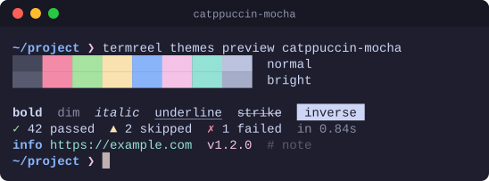 |
| `dracula` | The Dracula palette: purple-gray background, vivid neon accents. | 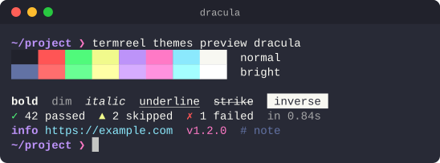 |
| `github-light` | A light theme in the style of GitHub's light UI. | 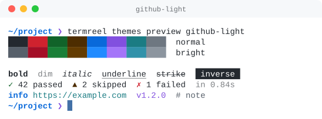 |
| `gruvbox-dark` | Gruvbox dark: retro, warm and earthy. | 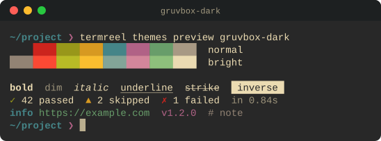 |
| `monokai` | Monokai: warm olive background with saturated accents. | 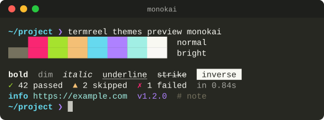 |
| `nord` | Nord: an arctic, north-bluish palette. | 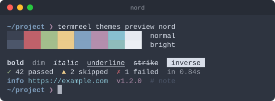 |
| `one-dark` | Atom's One Dark: muted, balanced colors on a cool gray. | 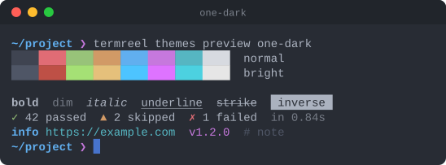 |
| `solarized-dark` | Solarized dark: Ethan Schoonover's low-contrast precision palette. | 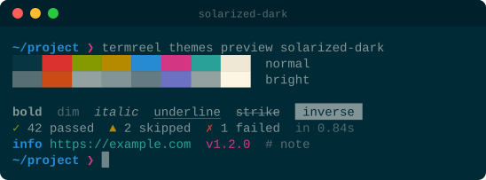 |
| `solarized-light` | Solarized light: the Solarized palette on its cream background. | 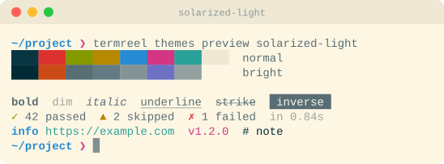 |
| `tokyo-night` | Tokyo Night: deep blue night with neon city lights. | 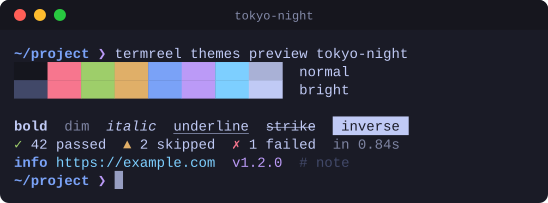 |
| `template` | The documented starting point for your own theme. | 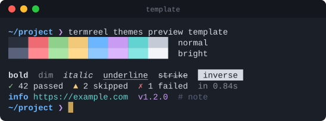 |
